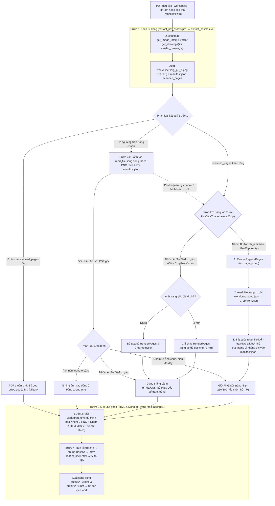

# luka-loop
Quy trình AI Agent tự động dịch tài liệu PDF tiếng Anh sang tiếng Việt. Không yêu cầu cài thêm bất cứ phần mềm hỗ trợ nào. Chỉ cần mở thư mục trên [Antigravity](https://antigravity.google/) là bắt đầu dùng được ngay.

Định dạng đầu ra mặc định: Bản dịch tiếng Việt trả về ở cả 2 định dạng đồng thời là HTML và PDF.

## Yêu cầu hệ thống
- **Hệ điều hành:** Windows 10 hoặc Windows 11 **64-bit (x64)** *(bộ công cụ `extract_assets.exe` hiện biên dịch ở kiến trúc x64, chưa hỗ trợ Windows 32-bit), hầu hết các máy tính hiện nay trên thị trường đều là bản 64-bit*.
- **PowerShell:** Hỗ trợ cả **Windows PowerShell 5.1** (có sẵn mặc định trên Windows 10/11) lẫn **PowerShell 7+** (`pwsh.exe`), không yêu cầu cấu hình thêm.
- **Trình duyệt (tùy chọn để tự động xuất PDF):** Công cụ dùng Microsoft Edge (ưu tiên) hoặc Google Chrome để xuất tệp PDF. Nếu không có, quy trình vẫn xuất hoàn chỉnh tệp `*_vi.html`.

## Lý do tồn tại
Tôi đã có sản phẩm https://github.com/kiencang/PDF-silaTranslator có chức năng tương đương, nhưng hiện tại chỉ API Key trả phí mới sử dụng được. 

luka-loop sử dụng agent Gemini thông qua Antigravity, và hoàn toàn dùng được với tài khoản miễn phí. Ngoài ra, việc sử dụng các thư viện python chất lượng cao như PyMuPDF giúp công cụ có sự cải tiến tốt hơn trong khả năng tách ảnh.

## Cách dùng
Rất đơn giản, bạn tải trực tiếp gói dựng sẵn mới nhất tại đây (chỉ cần tải 1 lần, đã kèm sẵn toàn bộ công cụ):

- **Tải trực tiếp bản mới nhất:** [luka-loop-win-x64.zip](https://github.com/kiencang/luka-loop/releases/latest/download/luka-loop-win-x64.zip)
- *(Nếu mở trang [GitHub Releases](https://github.com/kiencang/luka-loop/releases), hãy chọn tệp **`luka-loop-win-x64.zip`** trong mục **Assets** — không tải `Source code (zip)` vì gói mã nguồn thô từ Git không kèm sẵn `extract_assets.exe`).*

Sau đó giải nén file zip đó ở bất kỳ thư mục làm việc nào mà bạn muốn. Khi giải nén, nhớ chọn tùy chọn `Extract Here`, mở thư mục `luka-loop` vừa giải nén thấy ngay file có tên `AGENTS.md` nghĩa là bạn đã giải nén thành công.

Phần khó nhất đã xong! Giờ để dùng công cụ dịch, bạn chỉ việc vào Antigravity, chọn Workspace > Create Project > Add Folder, rồi bạn thêm thư mục vừa giải nén xong là OK.

Giờ thì bạn chỉ việc tải file PDF rồi gõ câu lệnh kiểu như `Dịch tài liệu sang tiếng Việt.` là agent Gemini sẽ tiến hành dịch, và gửi kết quả về cả ở 2 định dạng HTML và PDF. Nếu muốn giữ sát bố cục/thiết kế gốc từng trang của PDF (slide, brochure, tạp chí nhiều cột...), hãy nêu rõ trong yêu cầu (ví dụ: `Dịch tài liệu sang tiếng Việt và bảo toàn thiết kế/layout.`).

**Lưu ý**:
- Khi làm việc với Antigravity nên chọn chế độ **Turbo** (thay vì mặc định Request Review) để không phải liên tục nhận được các câu hỏi xác nhận quyền thực thi.
- Nếu đặt thư mục `luka-loop` bên trong vùng đồng bộ đám mây (OneDrive, Google Drive, Dropbox...), hãy bật tùy chọn giữ tệp ngoại tuyến trên máy (*Always keep on this device* / *Mirror files* / *Available offline*) để `extract_assets.exe` nạp đủ các thư viện đi kèm và tránh lồng đường dẫn quá sâu vượt giới hạn ký tự trên Windows.

## Cấu trúc dự án
- [`AGENTS.md`](./AGENTS.md) — Quy tắc điều phối dành cho AI Agent trong workspace.
- [`.agents/skills/pdf-to-html-vi/`](./.agents/skills/pdf-to-html-vi/) — Skill mặc định `pdf-to-html-vi` (đọc mượt 1 cột) gồm quy trình 4 bước ([`SKILL.md`](./.agents/skills/pdf-to-html-vi/SKILL.md)) và bộ chuẩn dịch thuật học thuật / CSS ([`si_academic_html.md`](./.agents/skills/pdf-to-html-vi/si_academic_html.md)).
- [`.agents/skills/pdf-to-html-vi-layout/`](./.agents/skills/pdf-to-html-vi-layout/) — Skill tùy chọn `pdf-to-html-vi-layout` (kích hoạt khi yêu cầu bảo toàn thiết kế/layout) gồm quy trình tách pha tiết kiệm token ([`SKILL.md`](./.agents/skills/pdf-to-html-vi-layout/SKILL.md)), bộ quy chuẩn chuyên dịch ([`si_translation.md`](./.agents/skills/pdf-to-html-vi-layout/si_translation.md)) và bộ quy chuẩn thiết kế từng trang ([`si_layout.md`](./.agents/skills/pdf-to-html-vi-layout/si_layout.md)).
- [`tools/`](./tools/) — Bộ công cụ thực thi portable (`extract_assets.exe`) cùng các script PowerShell bọc CLI mỏng:
  - [`extract_pdf_assets.ps1`](./tools/extract_pdf_assets.ps1) gọi `tools/extract_assets/extract_assets.exe` để phân giải tệp PDF (qua `-PdfPath` hoặc `-TranscriptPath`), tách ảnh/sơ đồ, xuất `manifest.json` và thu gọn tóm tắt trên stdout.
  - [`pdf_fallback_tools.ps1`](./tools/pdf_fallback_tools.ps1) gọi `tools/extract_assets/extract_assets.exe` (PyMuPDF) để render trang PDF scan và cắt khung ảnh theo JSON kèm auto-trim và kiểm tra giới hạn thư mục.
  - [`html_packager.ps1`](./tools/html_packager.ps1) chuyển tiếp sang `tools/extract_assets/extract_assets.exe` để tối ưu & nhúng ảnh Base64 trong bộ nhớ (không tạo ảnh tạm trên đĩa), bơm lớp vỏ đọc [`reader_shell.html`](./tools/reader_shell.html) (hoặc bỏ qua khi bật `-PreserveLayout`), kiểm định Auto-QA, tự động đánh số chống ghi đè (`_2`, `_3`...), xuất PDF và dọn sạch `work/`.
  - [`_path_guards.ps1`](./tools/_path_guards.ps1) — Tiện ích PowerShell kiểm tra an toàn đường dẫn và gọi `extract_assets.exe` (kèm phát hiện tệp đám mây offline).
  - [`src/`](./tools/src/) ([`extract_assets.py`](./tools/src/extract_assets.py), [`html_packager_core.py`](./tools/src/html_packager_core.py), [`path_guards.py`](./tools/src/path_guards.py)) & [`src/requirements-build.txt`](./tools/src/requirements-build.txt) — Mã nguồn Python gốc và danh sách gói ghim phiên bản dùng trên GitHub Actions (hoặc chạy [`build_extractor.ps1`](./tools/build_extractor.ps1) khi phát triển ở máy cá nhân) để biên dịch ra `extract_assets.exe` *(khi chạy dịch thuật tuyệt đối không gọi Python hệ thống)*.
- `output/` — Thư mục chứa tệp đầu ra (`*_vi.html`/`*_vi.pdf` cho bản đọc mượt mặc định; `*_layout_vi.html`/`*_layout_vi.pdf` cho bản bảo toàn thiết kế; tự động thêm `_2`, `_3`... nếu dịch lại nhiều lần cùng một file), tự động được tạo khi đóng gói và được bỏ qua bởi [`.gitignore`](./.gitignore).

## Cách công cụ xử lý ảnh

Công cụ kết hợp tách ảnh tự động bằng PyMuPDF (`extract_assets.exe`) ở Bước 1 cho cả **ảnh bitmap** lẫn **sơ đồ/biểu đồ vector**, kèm cơ chế **Sàng lọc trước khi Cắt (`Triage before Crop`)** để không lãng phí công đoạn cắt thủ công cho các sơ đồ đơn giản dựng lại được bằng HTML/CSS, đồng thời bắt buộc đối chiếu trực quan song song các tệp PNG đã tách trước khi đóng gói:

## Cách công cụ giảm dung lượng ảnh
Đây là phần thông tin kỹ thuật, phục vụ mục đích bảo trì là chủ yếu, người dùng có thể bỏ qua nếu không quan tâm. 

Ở Bước 4, [`html_packager.ps1`](./tools/html_packager.ps1) gọi `extract_assets.exe` ([`html_packager_core.py`](./tools/src/html_packager_core.py) & [`extract_assets.py`](./tools/src/extract_assets.py)) để tối ưu từng ảnh cục bộ ngay trong RAM trước khi mã hóa Base64 nhúng vào HTML:

```mermaid
flowchart TD
    IN["Thẻ img cục bộ trong draft.html (.png / .jpg / .jpeg)"] --> CACHE{"Đã có trong opt_cache (ảnh lặp lại)?"}
    CACHE -->|"Có"| REUSE["Dùng lại chuỗi data URI Base64 đã lưu trong RAM"]
    CACHE -->|"Chưa"| READ["Đọc orig_bytes vào RAM & xác định orig_mime; chuẩn hóa CMYK sang RGB/Gray"]

    subgraph ANALYZE["1. Phân tích lưới mẫu ~60x60 điểm ảnh (_analyze_sample_grid)"]
        READ --> ALPHACHK{"Có điểm nào alpha nhỏ hơn 250?"}
        ALPHACHK -->|"Có"| HA1["has_alpha = True (có nền trong suốt)"]
        ALPHACHK -->|"Không"| HA0["has_alpha = False (ảnh đặc)"]

        HA1 --> GRAYCHK
        HA0 --> GRAYCHK{"Mọi điểm mẫu đều là thang xám (max-min <= 2)?"}
        GRAYCHK -->|"Có"| C8["Đếm sắc độ xám 8-bit (0..255)"]
        GRAYCHK -->|"Không (ảnh có màu)"| C15["Đếm cụm màu 15-bit (r>>3, g>>3, b>>3)"]

        C8 --> RICH{"distinct_colors >= 200?"}
        C15 --> RICH
        RICH -->|"Đúng"| R1["is_rich_photo = True (ảnh chụp / X-quang / ảnh nhiệt)"]
        RICH -->|"Sai"| R0["is_rich_photo = False (sơ đồ / chữ / biểu đồ ít màu)"]
    end

    subgraph RESIZE["2. Kiểm tra giới hạn chiều ngang (MaxImageWidth = 1400 px)"]
        R1 --> WCHK
        R0 --> WCHK{"MaxImageWidth > 0 và width > 1400 px?"}
        WCHK -->|"Có"| DO_RS["Co kích thước giữ tỷ lệ về 1400 px -> work_pix (was_resized = True)"]
        WCHK -->|"Không"| NO_RS["Giữ kích thước gốc -> work_pix (was_resized = False)"]
    end

    subgraph COMPRESS["3. Chọn định dạng nén nhỏ hơn & giữ chất lượng (_optimize_image_bytes)"]
        DO_RS --> J_ELIG
        NO_RS --> J_ELIG{"Không trong suốt (!has_alpha) VÀ (is_rich_photo HOẶC đã resize từ JPEG gốc)?"}

        J_ELIG -->|"Có"| EN_JPG["Bỏ alpha dư (nếu có) & nén work_pix sang JPEG (quality = 95)"]
        EN_JPG --> J_SZ{"was_resized=True: jpg < orig_bytes? | was_resized=False: jpg <= 85% orig_bytes?"}
        J_SZ -->|"Đạt"| OUT_JPG["Trả về JPEG đã tối ưu (image/jpeg)"]
        J_SZ -->|"Không đạt"| P_ELIG

        J_ELIG -->|"Không"| P_ELIG{"was_resized = True VÀ orig_mime là image/png?"}
        P_ELIG -->|"Có"| EN_PNG["Xuất work_pix sang PNG không mất dữ liệu"]
        EN_PNG --> P_SZ{"png < orig_bytes?"}
        P_SZ -->|"Đạt"| OUT_PNG["Trả về PNG đã thu nhỏ (image/png)"]
        P_SZ -->|"Không đạt"| OUT_ORIG

        P_ELIG -->|"Không"| OUT_ORIG["Giữ nguyên 100% orig_bytes & orig_mime ban đầu"]
    end

    OUT_JPG --> B64["Mã hóa Base64 trong RAM -> lưu opt_cache -> nhúng vào HTML"]
    OUT_PNG --> B64
    OUT_ORIG --> B64
    REUSE --> DONE["Nhúng hoàn tất (không tạo ảnh tạm trên đĩa)"]
    B64 --> DONE
```

**Tóm tắt ý nghĩa 3 chốt bảo vệ:**
1. **Không làm nhòe sơ đồ nét mảnh:** Chỉ ảnh đặc (`!has_alpha`) và nhiều màu/sắc độ (`>= 200`) mới chuyển sang JPEG `95`; sơ đồ ít màu hoặc ảnh trong suốt luôn giữ PNG (chỉ thu nhỏ khi quá `1400 px`).
2. **Không bao giờ làm phình file:** Nếu bản nén lại không nhẹ hơn gốc (hoặc ảnh chụp không resize mà tiết kiệm dưới `15%`), công cụ tự động quay về dùng ảnh gốc.
3. **Không xử lý trùng lặp & không ghi rác ra đĩa:** Toàn bộ quá trình chạy trên RAM và dùng `opt_cache` nếu cùng một ảnh xuất hiện nhiều lần trong tài liệu.

## Tuyên bố từ chối trách nhiệm
Công cụ này có thể được sử dụng cho mục đích nghiên cứu và học tập cá nhân.

`luka-loop` cũng như người phát triển nó không đưa ra bất kỳ bảo đảm rõ ràng hay ngụ ý nào, cũng như không tuyên bố rằng công cụ sẽ vận hành hoàn hảo, chính xác hoặc cập nhật. Người phát triển sẽ không chịu trách nhiệm cho bất kỳ tổn thất hay thiệt hại nào phát sinh trực tiếp hoặc gián tiếp liên quan đến hoặc phát sinh từ việc sử dụng công cụ này.

## Giấy phép & Thành phần Bên thứ ba (License & Third-Party Notices)

- **Mã nguồn gốc của `luka-loop`:** Phần kịch bản điều phối Agent, Skill, script PowerShell, lớp vỏ [`tools/reader_shell.html`](./tools/reader_shell.html) và bộ mã nguồn tự viết trong [`tools/src/`](./tools/src/) ([`extract_assets.py`](./tools/src/extract_assets.py), [`html_packager_core.py`](./tools/src/html_packager_core.py), [`path_guards.py`](./tools/src/path_guards.py)) được cấp phép theo **MIT License** — xem chi tiết tại [`LICENSE`](./LICENSE).
- **Bộ công cụ thực thi dựng sẵn (`tools/extract_assets/`):** Bản đóng gói portable phân phối kèm trong gói phát hành Release (`luka-loop-win-x64.zip`, biên dịch tự động qua GitHub Actions từ [`tools/build_extractor.ps1`](./tools/build_extractor.ps1)) có tích hợp các thành phần phần mềm bên thứ ba và chịu sự điều chỉnh của giấy phép tương ứng từng thành phần:
  - **PyMuPDF / MuPDF:** Cấp phép theo **AGPL-3.0**; toàn bộ mã nguồn tương ứng của công cụ thực thi được công khai đầy đủ tại [`tools/src/`](./tools/src/).
  - **Python 3.12.7:** Cấp phép theo **PSF License v2**.
  - **OpenSSL 3.0.15 (`libcrypto-3.dll`):** Cấp phép theo **Apache License 2.0**.
  - **PyInstaller:** Bootloader theo **GPL-2.0-or-later** (kèm *Bootloader Exception*) và runtime hooks theo **Apache License 2.0**.
  - **Microsoft Visual C++ Runtime / Universal CRT:** Thuộc bản quyền của Microsoft Corporation.

Vui lòng xem đầy đủ thông báo bản quyền và toàn văn các giấy phép bên thứ ba tại [`THIRD_PARTY_LICENSES.md`](./THIRD_PARTY_LICENSES.md) và thư mục [`licenses/`](./licenses/).
