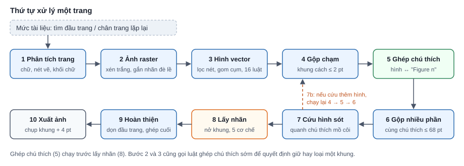
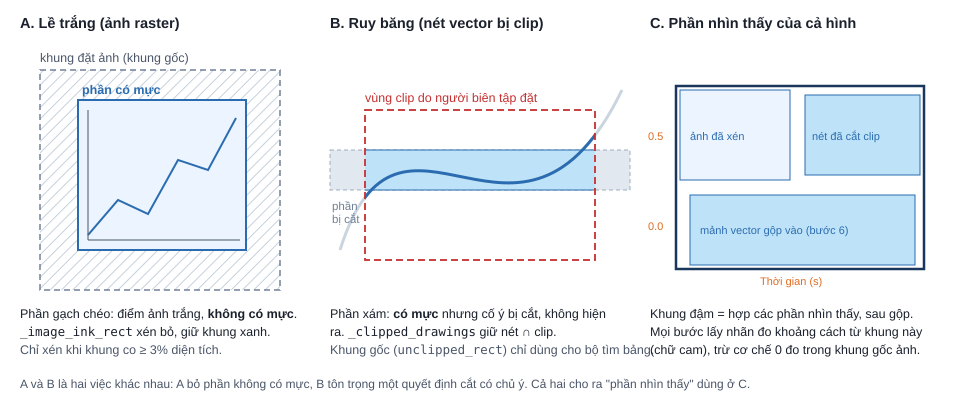
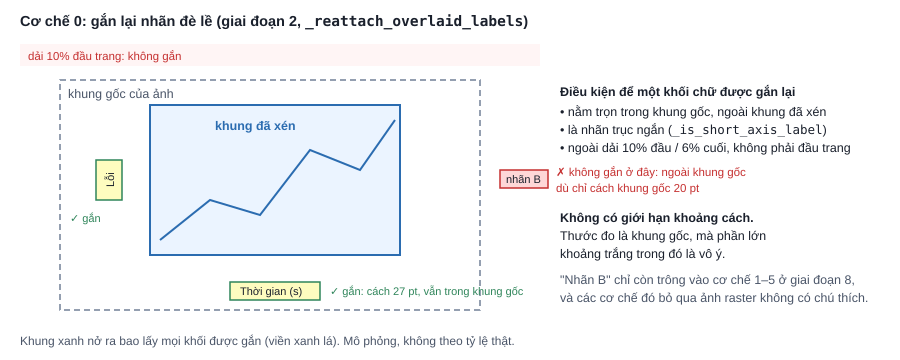
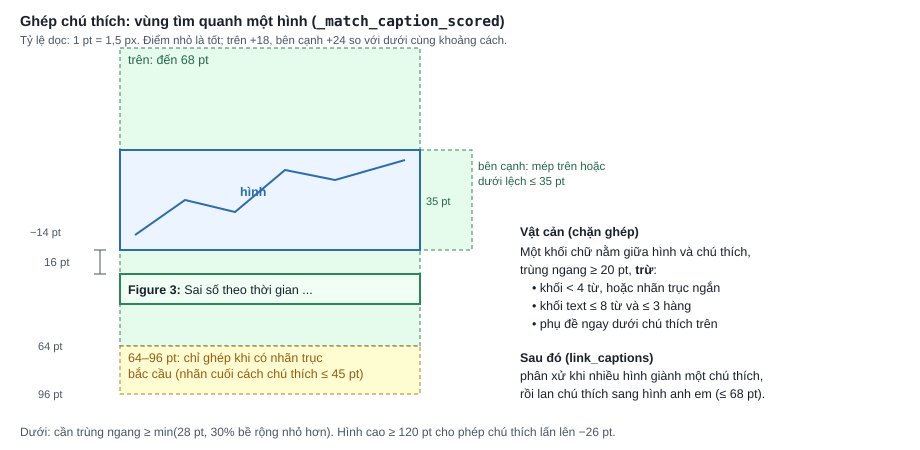
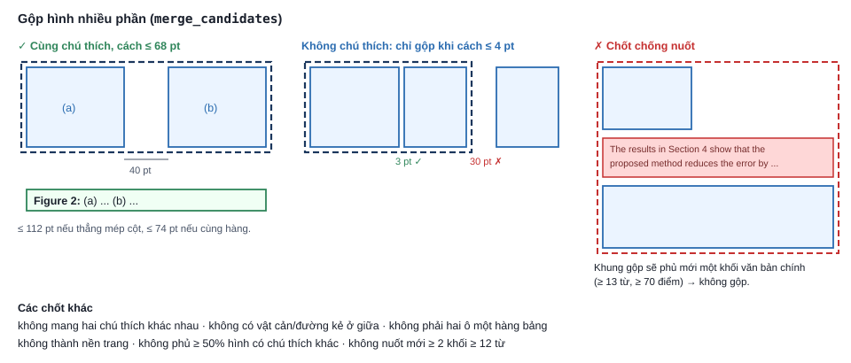
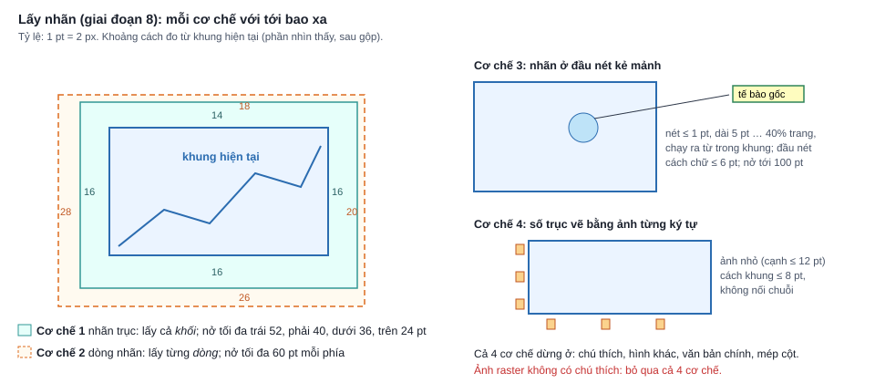
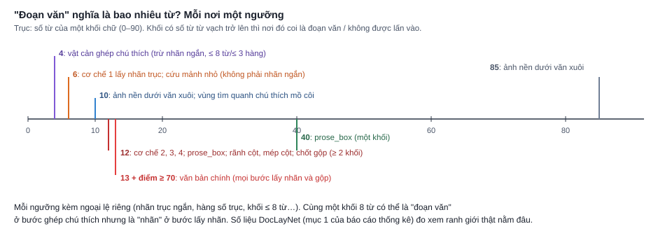

# Bản đồ luật của bộ dò hình (figure_detector)

Tài liệu này mô tả **bộ dò hình đang chạy thế nào** ở bản v1.1.45 (`main` = 923caf7), đọc trực tiếp từ mã nguồn
`tools/src/figure_detector/`. Mục đích: thấy toàn cảnh trước khi thiết kế lại cho thống nhất. Tài liệu không đánh giá
luật nào đúng hay sai; phần "Nhận xét" ở cuối mới nêu chỗ chồng chéo.

Quy ước: mọi khoảng cách tính bằng pt (1/72 inch); `pw`, `ph` là bề rộng, bề cao trang. Tên hàm in `như_thế_này`,
kèm tệp chứa nó. "Khối chữ" là `TextBlock`; "dòng" là một dòng chữ của PyMuPDF (khóa `(block, line)` của `get_text("words")`).

Các hình minh họa (thư mục `img/detector_rules/`) là **sơ đồ mô phỏng** cách công cụ xử lý, vẽ tay bằng SVG, không phải
trang tài liệu thật; ngưỡng ghi trên hình lấy đúng từ mã, còn kích thước chỉ gần đúng.

---

## 1. Toàn cảnh

Bộ dò chạy theo hai mức:

1. **Mức tài liệu** (`extract.py`, `running_heads.py`): trước khi xử lý từng trang, đọc dòng trên cùng và dưới cùng của
   mọi trang để tìm **đầu trang / chân trang lặp lại** (running heads, số trang).
2. **Mức trang** (`pipeline._run_page_pipeline`): mỗi trang đi qua các giai đoạn dưới đây, theo đúng thứ tự thực thi.

| # | Giai đoạn | Hàm / tệp | Làm gì |
| :- | :--- | :--- | :--- |
| 1 | Phân tích trang | `analyze_page` · text.py | Đọc chữ, nét vẽ (đã cắt theo clip), từ; dựng khối chữ, phân loại chú thích |
| 2 | Ảnh raster | `detect_raster_regions` · raster.py | Lấy khung ảnh, xén lề trắng, **gắn lại nhãn đè lề**, loại nền/ruy băng/watermark |
| 3 | Hình vector | `detect_vector_regions` · vector.py | Lọc nét vẽ, gom cụm (5 pt), chấm cụm qua 16 luật loại |
| 4 | Gộp chạm + bỏ tab mép trang | `_merge_touching`, `_drop_page_edge_tabs` | Gộp khung chạm nhau (2 pt) |
| 5 | Ghép chú thích | `link_captions` · captions.py | Ghép hình–chú thích, phân xử tranh chấp, lan sang hình anh em |
| 6 | Gộp hình nhiều phần | `merge_candidates` · merge.py | Gộp các mảnh cùng một hình, có các chốt chống "nuốt" |
| 7 | Cứu hình bị bỏ sót | `_recover_orphan_caption_vectors`, `rescue_small_vector_pieces` | Tìm hình vector quanh chú thích mồ côi; gom mảnh nhỏ bị loại |
| 7b | (nếu 7 tìm thêm) | lặp lại 4 → 5 → 6 | |
| 8 | Lấy nhãn | 5 hàm trong pipeline.py | Nở khung để lấy nhãn trục, dòng nhãn, nhãn đầu nét kẻ, chữ vẽ bằng ảnh nhỏ |
| 9 | Hoàn thiện | `_clear_running_heads`, lọc hình vector nhỏ, `_pair_last_orphan_caption`, `_maximize_captions` | Dọn đầu trang, ghép cặp cuối cùng |
| 10 | Xuất ảnh | `extract_images` · extract.py | Chụp vùng trang của khung (đệm 4 pt), ghi manifest |

Ở bước xuất, ảnh được **chụp từ trang đã dựng** (`page.get_pixmap(clip=khung + 4 pt)`), nên chữ PDF đè lên hình cũng có
trong ảnh. Muốn ảnh đúng thì chỉ cần khung đúng.

---

## 2. Dữ liệu đầu vào của mỗi trang (giai đoạn 1)

`analyze_page` (text.py) đọc trang **một lần** và dựng `PageContext` (model.py):

| Dữ liệu | Cách lấy | Ghi chú |
| :--- | :--- | :--- |
| `drawings` | `_clipped_drawings`: `get_drawings(extended=True)`, cắt mỗi nét theo vùng clip hiệu lực | **Chữa "dải ruy băng"** (1001.1751 p1). Nét nằm hẳn ngoài clip bị bỏ. Khung gốc giữ ở `unclipped_rect` cho bộ tìm bảng |
| `separator_rules` | nét vẽ cao ≤ 4 pt và rộng ≥ 25% pw, hoặc rộng ≤ 4 pt và cao ≥ 30% ph | Đường kẻ phân cách |
| `text_blocks` | khối `dict` của PyMuPDF, tách thêm bởi `_split_dict_block` | Tách khi hai dòng cách nhau theo chiều ngang ≥ 12 pt (`col_split_gap_x`) hoặc khi một dòng bắt đầu chú thích mới |
| | rồi `_merge_caption_continuations` | Nối dòng tiếp của chú thích bị tách: cách ≤ 5.5 pt, lệch trái −10…+60 pt, không có đường kẻ giữa |
| `kind` của khối | `_classify_text_block` | `fig_caption` / `tab_caption` / `text`. Bắt đầu bằng "Figure/Fig./Hình/Scheme/Chart/Plate/Diagram + số" (hay "Table/Bảng + số"), trừ khi theo sau là văn xuôi ("Figure 3 shows…", "Fig. 2)", ", which…") |
| `word_count`, `rows` | số từ (tách theo khoảng trắng); số hàng nhìn thấy (dòng chồng nhau ≥ 40% chiều cao tính một hàng) | |
| `words`, `word_rects` | `get_text("words")` | |
| `running_heads` | từ mức tài liệu (mục 3) | |
| `image_rects` | khung mọi ảnh đặt trên trang (đặt ở giai đoạn 2) | Dùng cho bước chữ vẽ bằng ảnh nhỏ |
| `main_text` | tính lần đầu khi cần (main_text.py) | Mục 9 |

**Lưu ý:** không có bước nào phân loại khối chữ cho cả trang ngoài ba loại `kind` trên. Mọi khái niệm khác ("đoạn văn",
"nhãn", "văn bản chính") do từng giai đoạn tự định nghĩa (mục 11).

Hình trên tách hai việc hay bị nhầm: **lề trắng** là phần không có mực của ảnh raster (bị xén ở giai đoạn 2), còn
**ruy băng** là phần có mực của nét vector mà người biên tập cố ý cắt bằng clip (bị cắt ngay ở giai đoạn 1). Sau hai
bước đó, mọi giai đoạn chỉ làm việc với phần nhìn thấy (xem thêm mục 11.2).

---

## 3. Đầu trang / chân trang lặp lại (mức tài liệu)

`running_heads.py`:

- Mỗi trang lấy **hàng dòng trên cùng** (nằm trong 16% đầu trang) và **hàng dòng dưới cùng** (trong 10% cuối trang), tối
  đa 16 từ. Số được thay bằng `#` để so khớp ("Page 12" = "Page 13").
- Một dòng là đầu trang nếu cùng chữ đó xuất hiện ở **≥ 2 trang khác** trong phạm vi ±8 trang, cùng độ cao ±3 pt.
- Dòng gần như toàn số (< 3 chữ cái) phải **đổi** giữa các trang (số trang thật); nhãn số trục giống hệt nhau thì không tính.
- `ctx.is_running_head(r)`: ≥ 50% diện tích `r` nằm trong các đầu trang tìm được.

Ngoài cơ chế này, nhiều giai đoạn vẫn dùng **dải cố định** theo tỷ lệ trang (mục 11.3).

---

## 4. Ảnh raster (giai đoạn 2)

`detect_raster_regions` (raster.py), với mỗi ảnh đặt trên trang (`get_image_info`):

| Bước | Luật | Ngưỡng |
| :--- | :--- | :--- |
| Bỏ ảnh rỗng | khung < 1 pt | |
| Ảnh nền trang | `_is_page_background`: diện tích ≥ 78% trang, hoặc rộng ≥ 90% và cao ≥ 85% | Đánh dấu "trang scan" |
| Dải dọc mép trang | `_is_vertical_bleed_strip`: cao ≥ 92% ph, rộng ≤ 18% pw, sát mép trái/phải 12 pt, **và không có chú thích** | |
| **Xén lề trắng** | `_image_ink_rect`: giải mã **điểm ảnh của chính ảnh nhúng** (áp soft mask nếu có, thu nhỏ ≤ 1600 px), tìm vùng điểm ảnh < 247 (không trắng), nới 2–3 px, ánh xạ ra tọa độ trang | Chỉ khi trang ≤ 40 ảnh, ảnh ≥ 1600 pt², ≤ 60 triệu điểm ảnh, và khung co ≥ 3% diện tích |
| **Gắn lại nhãn đè lề** | `_reattach_overlaid_labels`: khối chữ nằm trọn trong **khung gốc**, ngoài khung đã xén, ngoài dải 10% đầu và 6% cuối trang, không phải đầu trang, **và là `_is_short_axis_label`** → nở khung đã xén ra bao lấy | Không giới hạn khoảng cách, chỉ cần trong khung gốc |
| Gộp chạm | `_merge_touching` 2 pt | |
| Nền trang ghép từ nhiều ảnh | như trên, sau khi gộp | |
| Cỡ tối thiểu | cạnh ≥ 36 pt và diện tích ≥ 1600 pt², **hoặc** dải: cạnh ngắn ≥ 16, cạnh dài ≥ 100, diện tích ≥ 1800 | |
| Dải ngang/dọc mép trang, banner đầu trang | `_is_full_bleed_edge_strip` (rộng ≥ 92% pw, cao ≤ 16% ph, sát mép 12 pt), `_is_hero_header_banner` (sát đỉnh 8 pt, cao ≤ 22% ph, ≥ 4 từ đè lên) — **chỉ khi không có chú thích** | |
| Trang trí lề | `_is_edge_ornament`: cao < 62 pt và nằm trong dải 54 pt đầu / 45 pt cuối (…), trừ khi có chú thích ngay dưới (< 40 pt) | |
| Dải nhỏ có chữ đè (không chú thích) | dải không đạt cỡ thường mà có từ đè lên ≥ 45% chiều cao | |
| Ảnh nền dưới văn xuôi (không chú thích) | ≥ 3 khối "văn xuôi" (≥ **10** từ, chồng ≥ 50%) tổng ≥ 85 từ, hoặc một khối ≥ 85 từ phủ ≥ 75% ảnh | Watermark, nền trang trí |

Chú thích ở đây kiểm tra bằng `_match_caption` (mục 7), tức là đã dùng luật ghép chú thích **trước** giai đoạn ghép chú thích.

---

## 5. Hình vector (giai đoạn 3)

### 5.1 Lọc nét vẽ (`_filter_drawings`)

Bỏ: nét ngoài trang; nền trang; dải mép trang; đường ngang cao ≤ 4 pt rộng ≥ 62% pw; đường dọc rộng ≤ 4 pt cao ≥ 45% ph;
nét nằm trong **48 pt đầu / 40 pt cuối** trang mà cao < 28 pt; vùng tô không viền rộng ≥ 30% pw (nền khối), cao 4–24 pt
có chữ đè (tô sáng chữ), hay cao ≥ 45% ph rộng ≥ 12% pw có ≥ 10 từ (nền cột); khung thanh bên cao ≥ 45% ph có ≥ 25 từ
và không có chú thích; khung rỗng cao ≥ 40% ph bao ≥ 2 ảnh cách nhau ≥ 40 pt và có ≥ 10 từ; chữ watermark xám (≥ 4 nét,
có đè chữ). Trang > 200.000 nét bỏ qua giai đoạn vector; > 2.500 nét thì gộp lưới 6 pt; còn > 12.000 thì bỏ qua.

### 5.2 Gom cụm

`page.cluster_drawings`, dung sai **5 pt** mỗi chiều.

### 5.3 Chấm cụm (`_VECTOR_CLUSTER_RULES`, luật đầu tiên ra quyết định thắng)

| Luật | Loại khi |
| :--- | :--- |
| `page_background` | phủ gần hết trang |
| `too_small` | cạnh < 42 pt (phóng theo cỡ trang nếu không chú thích), trừ dải có chú thích hoặc sơ đồ con ngay trên chú thích |
| `edge_ornament` | như raster |
| `inner_table_caption` | không chú thích hình mà chứa ≥ 65% một chú thích bảng |
| `excessive_words` | > 200 từ không phải số trục |
| `uncaptioned_high_words` | > 80 từ không phải số trục, không chú thích |
| `table_caption` | ≥ 6 từ, có chú thích bảng, không có chú thích hình |
| `pymupdf_table` | ≥ 6 từ, ít đường cong (< 12), PyMuPDF nhận ra bảng ≥ 2×2 phủ > 45% (trừ bản đồ nhiệt dày) |
| `prose_box` | ≥ 20 từ, có ≥ 2 khối ≥ **12** từ không phải số trục (hoặc 1 khối ≥ **40**) — trừ hình có chú thích nhiều đường cong |
| `trivial_shape` | không ảnh, không chú thích, ≤ 2 hình |
| `tall_narrow_column` | không ảnh, không chú thích, cao ≥ 50% ph và rộng ≤ 18% pw |
| `ui_text_card` | thẻ giá/KPI: khung + chữ xếp chồng ≥ 4 dòng, ≥ 15 từ |
| `financial_numeric_table` | bảng số tô nền / kẻ dòng, ≥ 45% số |
| `hairline_table_grid` | chỉ gồm đường kẻ mảnh tạo lưới bảng |
| `outlined_glyph_confetti` | đám chữ/công thức vẽ bằng nét (≥ 120 nét nhỏ ≥ 72%, …) |
| `dense_poster_fragment` | mảnh nhỏ không chữ trên trang vỡ thành ≥ 80 cụm |

Cụm bị loại vì `too_small` được lưu lại cho bước cứu mảnh (7).

---

## 6. Gộp chạm và tab mép trang (giai đoạn 4)

- `_merge_touching`: gộp mọi khung raster + vector chạm nhau trong **2 pt**, trừ khi phần gộp thành nền trang.
- `_drop_page_edge_tabs`: bỏ khung chạm mép trên/dưới trang và nằm gọn trong dải 10% (tab chương, số trang tô màu).

---

## 7. Ghép chú thích (giai đoạn 5)

### 7.1 `_match_caption_scored` (caption_match.py) — một khung với mọi chú thích hình

| Vị trí | Điều kiện | Điểm (nhỏ là tốt) |
| :--- | :--- | :--- |
| Dưới | trùng ngang ≥ min(28 pt, 30% bề rộng nhỏ hơn); khoảng cách −26 (hình cao ≥ 120) hoặc −14 … **96 pt**; quá 64 pt thì cần "cầu" nhãn trục (mục dưới) | khoảng cách |
| Trên | khoảng cách −14 … **68 pt** | khoảng cách + 18 |
| Bên cạnh | trùng dọc ≥ min(10 pt, 35% chiều cao chú thích), mép trên hoặc dưới lệch ≤ 35 pt, cách ngang ≤ **35 pt** | khoảng cách + 24 |

**Vật cản** giữa hình và chú thích (chặn ghép): một khối chữ nằm giữa, trùng ngang ≥ 20 pt, **trừ** khối < 4 từ, nhãn
trục ngắn, khối `text` ≤ 8 từ và ≤ 3 hàng, hay dòng phụ đề ngay dưới chú thích trên (≤ 14 từ, ≤ 26 pt cao, cách ≤ 10 pt).
Chú thích dưới xa hơn 64 pt chỉ được ghép khi có nhãn trục ngắn bắc cầu và nhãn cuối cách chú thích ≤ 45 pt.

### 7.2 `link_captions` (captions.py)

1. Lưới 2 cột ≥ 4 đồ thị lớn không có nhãn (a)/(b) → không ghép gì.
2. Mỗi khung lấy chú thích điểm tốt nhất.
3. `_resolve_caption_conflicts`: một chú thích bị nhiều khung giành — luật A: trên/dưới thắng bên cạnh; luật B: chú thích
   kẹp giữa hai hình trên–dưới thì hình điểm kém hơn nhường (có trường hợp gương, Atlas p150).
4. `_propagate_captions`: khung không chú thích nhận chú thích của hình anh em cùng phía, cùng cột (cách ≤ 68 pt, ≤ 112 pt
   nếu thẳng mép) hoặc cùng hàng (≤ 42 pt, chiều cao không chênh quá 2.2 lần), không có vật cản / đường kẻ / chú thích lạ ở giữa.

### 7.3 Ghép sau cùng (giai đoạn 9)

- `_pair_last_orphan_caption`: trang chỉ còn đúng 1 hình không chú thích và 1 chú thích chưa ai lấy → ghép, nếu chú thích
  ≤ 10 dòng, cách ≤ 150 pt và không gần một hình đã có chú thích hơn chính chú thích của hình đó (+10 pt).
- `_maximize_captions`: đổi chú thích giữa hai hình khi việc đổi giúp cả hai cùng có chú thích (Atlas p213).

---

## 8. Gộp hình nhiều phần (giai đoạn 6)

`merge_candidates` (merge.py) gộp lặp cho đến khi không đổi. Hai khung gộp khi:

- không mang hai chú thích khác nhau;
- không có vật cản giữa (`_has_obstacle_between`: khối chữ hay đường kẻ nằm giữa; nếu cùng chú thích thì bỏ qua nhãn trục ngắn);
- không phải hai ô của một hàng bảng (`_is_table_row_pair`);
- khoảng cách: cùng chú thích ≤ **68 pt** (≤ 112 pt nếu thẳng mép cột, ≤ **74 pt** nếu cùng hàng); không chú thích ≤ **4 pt**;
- và không phạm **chốt chống nuốt** (`_violates_merge_invariants`):
  - phần gộp không thành nền trang;
  - không phủ ≥ 50% một hình mang chú thích khác;
  - không phủ ≥ 30% một chú thích mà không khung nào sở hữu hay chạm (`_spans_foreign_caption`);
  - **không phủ mới một khối văn bản chính** (mục 9);
  - không nuốt mới ≥ 2 khối ≥ **12** từ (≥ 65% diện tích mỗi khối).

---

## 9. Văn bản chính (main_text.py)

Khối `text` có ≥ **13** từ được chấm 8 đặc trưng theo bảng điểm lấy từ DocLayNet (tune); ≥ **70/100** điểm là văn bản
chính. Đặc trưng: số từ, bề rộng so với trang, ký tự mỗi hàng, tỷ lệ từ viết thường, tỷ lệ từ có chữ cái, tỷ lệ chữ số,
cùng phông chủ đạo của trang, cỡ chữ so với cỡ chủ đạo của trang (cỡ và phông chủ đạo tính theo số ký tự trên **trang đó**).

Dùng ở: chốt gộp (8) và cả 4 bước lấy nhãn (10) qua `_newly_covers_main_text` — một bước bị chặn nếu khung mới **chồng
quá 2 pt mỗi chiều** lên một khối văn bản chính mà khung cũ chưa chồng. Riêng bước nhãn trục gọi hàm này **không truyền
cấu hình** (dùng `DEFAULT_CONFIG`).

---

## 10. Lấy nhãn (giai đoạn 8) — 6 cơ chế

Tất cả đo từ **khung hiện tại** (sau xén trắng / cắt clip và sau gộp), trừ cơ chế 0 đo trong khung gốc của ảnh.
**Cơ chế 1–5 bỏ qua khung raster không có chú thích** (`source == "raster" and caption_idx is None`).

| # | Cơ chế | Lấy gì | Khoảng cách tối đa | Nở tối đa | Chặn bởi |
| :- | :--- | :--- | :--- | :--- | :--- |
| 0 | `_reattach_overlaid_labels` (giai đoạn 2) | khối nhãn trục ngắn trong khung gốc ảnh | không giới hạn (trong khung gốc) | khung gốc | dải 10%/6%, đầu trang |
| 1 | `_expand_plot_axis_labels` (chạy 2 lần: trước và sau gộp lại) | **khối** nhãn trục ngắn, theo từng phía | trái/phải/dưới 16, trên 14 pt (cho phép lấn vào khung 6 pt); lệch dọc/ngang ≤ 10–16 pt | trái 52, phải 40, dưới 36, trên 24 pt (so với khung ban đầu) | chú thích < 3 pt; văn bản chính; hình khác; khối "văn xuôi" (≥ **6** từ, không phải nhãn ngắn, hoặc chú thích) bị phủ ≥ 25%; mép cột; nhãn cách mép trang < 36 pt; đầu trang. Khung raster có chú thích chỉ lấy loại hẹp (≤ 32 pt / xoay / (a)) |
| 2 | `_attach_adjacent_label_lines` | **dòng** trông như nhãn (`_label_lines`) | trái 28, phải 20, trên 18, dưới 26 pt; hoặc dòng nằm vắt ≥ 30% trong khung | 60 pt mỗi phía | rãnh cột, mép cột, văn bản chính, chú thích (±2 pt), hình khác, khối ≥ **12** từ bị phủ ≥ 25% (trừ hàng số trục `_is_label_row` cách ≤ 5 pt), ô bảng PyMuPDF; dòng phía trên to hơn chữ thường 15% (tiêu đề) |
| 3 | `_attach_stroke_labels` | **khối** chữ ở đầu một nét kẻ mảnh (≤ 1 pt, dài 5 pt … 40% pw) chạy ra từ trong khung | đầu nét cách dòng ≤ 6 pt | 100 pt mỗi phía | khối > 10 từ hay có dòng > 8 từ; tiêu đề mục; đầu trang; mép cột; hình khác; văn bản chính; chú thích; khối ≥ **12** từ bị phủ ≥ 25%; gạch phân số bị loại khỏi nét |
| 4 | `_attach_glyph_images` | ảnh nhỏ (cạnh ≤ 12 pt) — số trục vẽ bằng ảnh từng ký tự | ≤ 8 pt từ khung trước bước này, không nối chuỗi | | nằm trong khối ≥ **12** từ (không phải nhãn ngắn), rãnh cột, mép cột, văn bản chính, chú thích, hình khác, ô bảng |

### 10.1 Các phép thử "là nhãn" hiện có

| Phép thử | Nơi dùng | Luật |
| :--- | :--- | :--- |
| `_is_short_axis_label` (text.py) | cơ chế 0, 1, cầu chú thích, vật cản, nhiều nơi khác | khối `text`, không phải tiêu đề mục, **và một trong**: hẹp ≤ 32 pt và (cao ≥ 1.4 lần rộng, hoặc cao ≤ 42 pt với ≤ 8 từ); cao ≤ 30 pt, ≤ 4 từ, không kết thúc bằng "."; rộng ≤ 115, cao ≤ 26, ≤ 10 từ, không có "."; cao ≤ 26, ≤ 12 từ, ≥ 60% là số trục; cao ≤ 26, ≤ 16 từ, bắt đầu bằng (a)/a) |
| `looks_like_label` trong `_label_lines` | cơ chế 2 | dòng ≤ 8 từ, rộng ≤ 55% pw, không kết thúc bằng . ; : , (khi ≥ 2 từ), không có gạch nối cuối dòng, không phải số công thức "(12)"; **mọi dòng của khối** phải đạt; không phải gạch đầu dòng, chú thích, tiêu đề mục, dòng nối tiếp văn xuôi trên cùng hàng (≤ 40 pt) |
| `_is_label_row` | cơ chế 2 (miễn chốt văn xuôi) | ≤ 24 từ, ≤ 2 hàng, mỗi từ ≤ 4 ký tự hoặc là số; cách khung ≤ 5 pt |
| khối nhãn đầu nét | cơ chế 3 | ≤ 10 từ, không dòng nào > 8 từ |
| nhãn không chặn chú thích | ghép chú thích | < 4 từ, nhãn ngắn, hoặc ≤ 8 từ và ≤ 3 hàng |

---

## 11. Các khái niệm đang được định nghĩa nhiều lần

### 11.1 "Đoạn văn" (khối chữ không được lấn vào / chặn)

Ba ngưỡng số từ dùng ở nhiều nơi được đặt tên trong `text.py` (`PARAGRAPH_MIN_WORDS = 12`, `SENTENCE_MIN_WORDS = 10`,
`PHRASE_MIN_WORDS = 6`), kèm các hàm `_is_paragraph`, `_is_sentence`, `_blocks_caption_search`, `_blocks_axis_labels`.
Cột "Hàm" cho biết nơi nào dùng hàm nào; chỗ trống là luật riêng, chưa gom.

| Nơi | Định nghĩa | Hàm |
| :--- | :--- | :--- |
| Ảnh nền dưới văn xuôi (raster) | ≥ 10 từ | `_is_sentence` |
| Vật cản ghép chú thích | ≥ 4 từ, trừ nhãn ngắn và ≤ 8 từ / ≤ 3 hàng | |
| Vùng tìm hình quanh chú thích mồ côi, sơ đồ con trên chú thích | ≥ 10 từ, hoặc chú thích | `_blocks_caption_search` |
| Luật `prose_box` (vector) | ≥ 12 từ không phải số trục (hoặc 1 khối ≥ 40) | |
| Cứu mảnh nhỏ (7) | ≥ 6 từ không phải nhãn ngắn, hoặc chú thích | `_blocks_axis_labels` |
| Chốt gộp | ≥ 12 từ (≥ 2 khối mới bị nuốt), **và** văn bản chính (13 từ + 70 điểm) | `_is_paragraph` |
| Rãnh cột, mép cột | ≥ 12 từ | `_is_paragraph` |
| Cơ chế 1 | ≥ 6 từ không phải nhãn ngắn, hoặc chú thích | `_blocks_axis_labels` |
| Cơ chế 2 | ≥ 12 từ không phải nhãn ngắn, trừ hàng số trục ≤ 5 pt | `_is_paragraph(axis_labels_ok=True)` |
| Cơ chế 3 | ≥ 12 từ | `_is_paragraph` |
| Cơ chế 4 | ≥ 12 từ không phải nhãn ngắn | `_is_paragraph(axis_labels_ok=True)` |
| Mọi bước lấy nhãn + gộp | văn bản chính: ≥ 13 từ và ≥ 70 điểm | `main_text_rects` |

Việc gom tên không đổi kết quả: cùng một ngưỡng 12 từ, có nơi bỏ qua nhãn trục ngắn (cơ chế 2, 4), có nơi không (rãnh
cột, chốt gộp, cơ chế 3). Hợp nhất các biến thể này là việc đổi luật, phải đo riêng.

### 11.2 Khung nào được dùng

| Khung | Dùng ở |
| :--- | :--- |
| Khung gốc ảnh (khung đặt trong PDF) | chỉ cơ chế 0; `image_rects` (cơ chế 4); chọn "nền trang", "dải mép" trước khi xén |
| Khung ảnh đã xén trắng | mọi bước sau giai đoạn 2 |
| Khung nét vẽ đã cắt clip | mọi bước, trừ bộ tìm bảng |
| Khung nét vẽ gốc (`unclipped_rect`) | chỉ bộ tìm bảng PyMuPDF (để nền trắng bị clip theo hình không bị coi là khung bảng, 1001.0583 p6) |

### 11.3 Dải đầu trang / chân trang

| Nơi | Dải |
| :--- | :--- |
| Đầu trang lặp lại (mức tài liệu) | tìm trong 16% đầu / 10% cuối |
| Cơ chế 0 và cơ chế 2 | 10% đầu / 6% cuối (cơ chế 2 thu hẹp dải đầu về đầu trang thật nếu biết) |
| Cơ chế 1 | 36 pt đầu / cuối |
| Lọc nét vẽ | 48 pt đầu / 40 pt cuối (nét cao < 28 pt) |
| Trang trí lề | 54 pt đầu / 45 pt cuối, … |
| Tab mép trang | 10% |
| Vùng tìm quanh chú thích mồ côi | chừa 24 pt mép |

### 11.4 Đơn vị ngưỡng

Phần lớn ngưỡng là **pt tuyệt đối** (16, 28, 42, 64, 68…), một số là **tỷ lệ trang** (10%, 55% pw, 62% pw…), một số
**phóng theo cỡ trang** (`min_vector_dim`, ngưỡng nét chữ). Không ngưỡng nào tính theo **cỡ chữ** của tài liệu, trừ
phép thử "dòng to hơn chữ thường 15%" ở cơ chế 2 và các đặc trưng của văn bản chính.

---

## 12. Nhận xét: chỗ chồng chéo và khó sửa

1. **Không có tầng phân loại chữ chung.** Mỗi giai đoạn tự đếm từ với ngưỡng riêng (4, 6, 10, 12, 13, 40, 85 từ), nên
   một khối có thể là "đoạn văn" ở bước này mà là "nhãn" ở bước khác. Mỗi lần chữa một ca lại thêm ngoại lệ vào một định
   nghĩa (hàng số trục, nhãn ngắn, khối ≤ 8 từ…).
2. **Bước xén trắng tự lấy nhãn** (cơ chế 0) bằng một luật khác hẳn các bước lấy nhãn còn lại, dựa vào khung gốc —
   thứ mà phần lớn trường hợp chỉ là khoảng trắng vô ý.
3. **Lấy nhãn rải ở 6 nơi** với 6 bộ khoảng cách và mức nở khác nhau; mỗi nơi lặp lại gần như cùng bộ chốt (chú thích,
   hình khác, văn bản chính, mép cột, rãnh cột, bảng) nhưng không hoàn toàn giống nhau (ví dụ rãnh cột không có ở cơ chế 1
   và 3; bảng không có ở cơ chế 1 và 3).
4. **Hình raster không chú thích không bao giờ được lấy nhãn** ở cơ chế 1–5. Ghép chú thích lại chạy trước lấy nhãn, nên
   một hàng nhãn nằm giữa hình và chú thích có thể chặn ghép, rồi hình thiếu chú thích lại không được lấy nhãn (Atlas p335).
5. **Luật ghép chú thích được gọi sớm** ở giai đoạn 2 và 3 (để quyết định giữ/loại), trước khi có khung cuối cùng.
6. **Dải đầu/chân trang có 6 định nghĩa** cố định, song song với cơ chế tìm đầu trang lặp lại theo tài liệu.
7. **Ngưỡng tuyệt đối bằng pt**, không theo cỡ chữ, nên tài liệu cỡ chữ lớn/nhỏ khác hẳn bài báo khoa học sẽ lệch.
8. Một số chỗ gọi hàm không truyền cấu hình (cơ chế 1 dùng `DEFAULT_CONFIG` cho chốt văn bản chính).

---

## 13. Chỉ số nên đo trên DocLayNet trước khi thiết kế lại

> Đã đo (2026-11-27): kết quả ở [doclaynet_reference.md](doclaynet_reference.md), bảng đầy đủ trong `doclaynet/`.

DocLayNet (mảng tài liệu khoa học, các tập tune/val/test; **không xem trang holdout**) có nhãn tay cho Picture, Caption,
Text, Section-header, Page-header/footer, Table, Formula, List-item. Đề xuất đo, mỗi chỉ số kèm phân bố (trung vị, p90,
p99) theo từng loại:

**Khối chữ**
- số từ, số hàng, bề rộng (pt và % trang), cỡ chữ so với cỡ chủ đạo, tỷ lệ số, tỷ lệ viết thường, khoảng trống lớn nhất
  giữa hai từ (theo cỡ chữ) — cho từng loại: chữ trong Picture (nhãn), Caption, Text, List-item, Section-header, Page-header.
- tỷ lệ khối mà điểm văn bản chính ≥ 70, theo loại.

**Nhãn của hình** (chữ nằm trong Picture nhưng ngoài phần nhìn thấy của ảnh/nét vẽ)
- khoảng cách từ nhãn đến phần nhìn thấy, theo phía (trái/phải/trên/dưới).
- số từ, số hàng, bề rộng của nhãn; bao nhiêu nhãn chỉ được với tới nếu nối chuỗi.

**Ảnh raster**
- khung gốc so với khung xén trắng: phần dư mỗi phía (pt, %).
- tỷ lệ ảnh có **chữ đè lên phần lề bị xén** (khoảng trắng có chủ ý) so với lề trống hoàn toàn (vô ý).
- khung Picture của DocLayNet so với khung gốc và khung xén: cái nào gần hơn.

**Nét vẽ**
- phần ruy băng (khung gốc − khung cắt clip) của các nét trong Picture.

**Quan hệ hình – chú thích**
- khoảng cách hình–chú thích theo phía (dưới/trên/bên cạnh), độ trùng ngang/dọc.
- chữ nằm giữa hình và chú thích: số từ, loại.
- tỷ lệ hình không có chú thích; hình raster không chú thích có nhãn ngoài phần nhìn thấy hay không.

**Hình nhiều phần**
- khoảng cách giữa các mảnh của cùng một Picture (raster/vector), theo hàng / cột.

**Vùng lề trang**
- vị trí Page-header/footer (pt và % trang) để thay 6 dải cố định bằng một định nghĩa.

Các phân bố này cho phép đặt ngưỡng từ dữ liệu (ví dụ: "nhãn cách phần nhìn thấy ≤ p99 = X pt") và hợp nhất các định
nghĩa ở mục 11 thành một tầng phân loại chữ và một bảng luật lấy nhãn.
