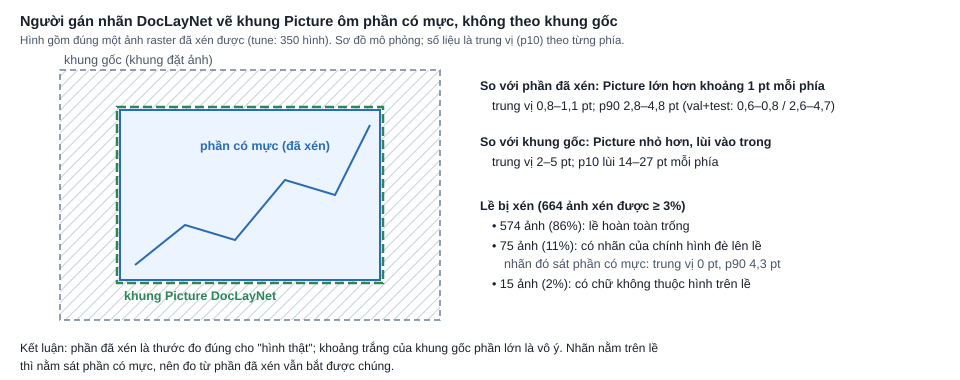
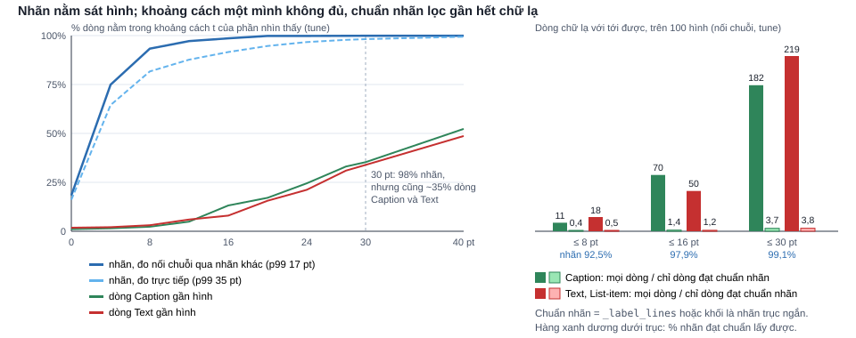
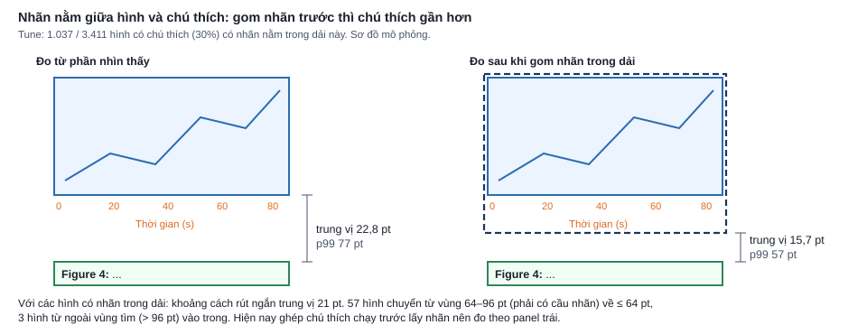

# DocLayNet làm dữ liệu tham khảo cho bộ dò hình

Tài liệu này ghi lại những gì đo được trên **DocLayNet v1.2, mảng bài báo khoa học** (trang arXiv), nhìn qua đúng
cách bộ dò hình của Luka-Loop đọc trang. Mục đích: khi chỉnh một luật trong `tools/src/figure_detector/`, có số liệu
để biết ngưỡng hiện tại đang nằm ở đâu so với tài liệu thật, thay vì sửa theo từng ca.

Đây là **số liệu tham khảo, không phải đề xuất sửa mã**. Bộ dò hiện tại đã bắt đúng phần lớn hình; mọi thay đổi vẫn
phải được xem xét riêng (vì sao mã gốc làm thế) và đo bằng `dev/eval_doclaynet.py`. Bản đồ luật hiện tại nằm ở
[detector_rules.md](detector_rules.md).

Các bảng đầy đủ: [doclaynet/report_tune.md](doclaynet/report_tune.md) (tập chọn ngưỡng) và
[doclaynet/report_val_test.md](doclaynet/report_val_test.md) (tập kiểm tra). Hình minh họa trong `img/doclaynet/` là sơ
đồ mô phỏng, số liệu ghi trên hình lấy từ báo cáo.

---

## 1. Dữ liệu và cách đo

| | |
| :--- | :--- |
| Nguồn | DocLayNet v1.2 (bản parquet), chỉ `doc_category = scientific_articles`: arxiv_doublespaced, arxiv_mediumspaced, arxiv_two_columns |
| Giấy phép | CDLA-Permissive-1.0. Giấy phép không hạn chế "kết quả" tính toán từ dữ liệu, nên các bảng tổng hợp ở đây được công bố. Dữ kiện thô từng trang (có trích chữ của bài báo) và ảnh trang **không** đưa vào kho |
| Tập | `tune` = train trừ holdout (9.863 trang dùng được), `val` + `test` (1.880 trang). **Holdout không được đọc** (cùng cách chia với `eval_doclaynet.py`) |
| Bỏ | trang xoay; không trang nào lỗi |
| Bộ dò | `analyze_page` với `DEFAULT_CONFIG` của bản v1.1.45 |

Hai script, chạy lại được:

```
python -X utf8 dev\doclaynet_facts.py --data D:\PdfSamples --subset tune --subset val --subset test
python -X utf8 dev\doclaynet_stats.py --subset tune
python -X utf8 dev\doclaynet_stats.py --subset val --subset test
```

`doclaynet_facts.py` (khoảng 30 phút, 7 tiến trình) ghi dữ kiện từng trang vào `%TEMP%\luka_doclaynet_eval\facts\v1\`:
khối chữ (số từ, 8 đặc trưng văn bản chính, điểm, khoảng trống lớn nhất giữa hai từ, các phép thử nhãn), dòng chữ, ảnh
(khung đặt và phần có mực sau xén), nét vẽ quanh hình (khung đã cắt clip và khung gốc), mỗi thứ gắn với khung DocLayNet
chứa tâm của nó. `doclaynet_stats.py` đọc dữ kiện đó và viết báo cáo vào `work-dev\doclaynet_stats\`.

**Định nghĩa dùng trong báo cáo**

- **Phần nhìn thấy** của một hình: hợp các ảnh (đã xén lề trắng đúng như bộ dò) và các nét vẽ (đã cắt theo clip) có tâm
  nằm trong khung Picture. Trang có hơn 5.000 nét vẽ quanh hình: phần vượt được gộp thành một khung.
- **Nhãn**: dòng chữ DocLayNet xếp vào Picture mà tâm nằm ngoài phần nhìn thấy.
- **Chữ lạ**: dòng chữ thuộc loại khác (Caption, Text, …) nằm trong 80 pt quanh phần nhìn thấy.
- **Nối chuỗi**: khoảng cách tính bằng bước lớn nhất phải nhảy từ phần nhìn thấy, qua các nhãn khác, đến dòng đó.
- **Chuẩn nhãn**: dòng đạt `_label_lines` hoặc khối chứa nó đạt `_is_short_axis_label`.

**Hạn chế**: chỉ bài báo khoa học tiếng Anh; mỗi trang được xử lý như một PDF một trang riêng (DocLayNet tách từng trang, dù một tài liệu đóng góp nhiều trang), nên không có ngữ cảnh cả tài liệu; gắn loại
theo tâm khối nên khối nằm vắt hai khung bị tính riêng ("khối lai"); phần nhìn thấy là xấp xỉ (lọc nền vector thô hơn
bộ dò). Số liệu mô tả **tài liệu**, không mô tả kết quả của bộ dò.

---

## 2. Khung hình: phần đã xén mới là "hình thật"



| Hình gồm đúng một ảnh raster (tune 350 / val+test 68) | trung vị | p10 | p90 |
| :--- | ---: | ---: | ---: |
| Khung Picture vượt phần đã xén, mỗi phía | 0,8–1,1 pt (0,6–0,8) | −1,1…−0,7 | 2,8–4,8 pt |
| Khung Picture vượt khung gốc, mỗi phía | −2…−5 pt | −14…−27 pt | 0–1,9 pt |

Lề bị xén (tune, 664 ảnh xén được ≥ 3%; val+test 145):

| | tune | val+test |
| :--- | ---: | ---: |
| lề hoàn toàn trống | 574 (86%) | 111 (77%) |
| có nhãn của chính hình đè lên lề | 75 (11%) | 30 (21%) |
| có chữ không thuộc hình trên lề | 15 (2%) | 4 (3%) |

Nhãn đè lên lề nằm sát phần có mực: trung vị 0 pt, p90 4,3 pt.

**Liên quan đến mã**: giai đoạn 2 xén lề (`_image_ink_rect`) đúng với cách người gán nhãn nhìn hình. Cơ chế 0
(`_reattach_overlaid_labels`) dựa vào khung gốc, nhưng khung gốc phần lớn là khoảng trắng vô ý; những nhãn thật nằm
trên lề thì cách phần có mực vài pt (detector_rules §4, §10, nhận xét 2).

---

## 3. Nhãn nằm rất gần phần nhìn thấy

| Dòng nhãn ngoài phần nhìn thấy | n | p50 | p90 | p99 |
| :--- | ---: | ---: | ---: | ---: |
| trực tiếp — tune | 18.563 | 2,6 | 14,0 | 35,5 |
| nối chuỗi — tune | 18.563 | 2,1 | 6,5 | 17,1 |
| trực tiếp — val+test | 4.194 | 2,1 | 10,9 | 30,8 |
| nối chuỗi — val+test | 4.194 | 1,6 | 5,0 | 15,0 |

Theo phía (tune, trực tiếp, p90 / p99): trái 18,5 / 40,3 (7.983 dòng, tên trục dọc nằm ngoài các số trục); dưới
14,1 / 29,2 (6.251); phải 8,9 / 23,5 (789); trên 12,9 / 64,0 (558).

Đặc điểm dòng nhãn: trung vị 1 từ, p99 5 từ; 91,9% đạt `_label_lines`, 96,8% thuộc khối nhãn trục ngắn, 2% thuộc khối
≥ 12 từ, 0% thuộc khối văn bản chính.

Theo loại hình (tune):

| loại | hình | có chú thích (≤ 100 pt) | có nhãn ngoài | trong đó không chú thích | nối chuỗi p50 / p90 / p99 |
| :--- | ---: | ---: | ---: | ---: | :--- |
| raster thuần | 779 | 747 | 75 (10%) | 13 | 2,8 / 14,1 / 19,1 |
| lai raster + vector | 240 | 233 | 95 (40%) | 1 | 1,6 / 5,6 / 17,1 |
| vector thuần | 2.519 | 2.442 | 1.132 (45%) | 38 | 2,2 / 6,5 / 17,1 |

**Liên quan đến mã**: các cơ chế lấy nhãn 1–4 với tới 14–28 pt mỗi phía (detector_rules §10), khớp với vùng chứa phần
lớn nhãn. Ảnh raster ít khi có nhãn ngoài (10%), và rất ít ảnh raster có nhãn mà không có chú thích (13 / 779): đó là
nhóm mà cơ chế 1–5 hiện bỏ qua.

---

## 4. Khoảng cách một mình không đủ; chuẩn nhãn lọc gần hết chữ lạ



Trong 30 pt quanh phần nhìn thấy (trực tiếp) có 98% nhãn, nhưng cũng có 35% dòng Caption và 34% dòng Text gần hình. Khi
chỉ nhận dòng đạt chuẩn nhãn (tune, nối chuỗi):

| ≤ t | nhãn lấy được | dòng Caption với tới: mọi / đạt chuẩn | Text, List-item: mọi / đạt chuẩn | loại khác: mọi / đạt chuẩn |
| ---: | ---: | ---: | ---: | ---: |
| 8 | 92,5% | 379 / 13 | 629 / 16 | 110 / 96 |
| 12 | 96,4% | 947 / 20 | 1.290 / 29 | 169 / 125 |
| 16 | 97,9% | 2.486 / 49 | 1.778 / 41 | 468 / 411 |
| 20 | 98,9% | 3.224 / 72 | 3.477 / 62 | 642 / 558 |
| 30 | 99,1% | 6.455 / 131 | 7.744 / 133 | 1.097 / 952 |

(tune có 3.538 hình có phần nhìn thấy; val+test cho cùng xu hướng, xem báo cáo.)

Chuẩn nhãn loại được khoảng 98% dòng Caption và Text gần hình. "Loại khác" (công thức, ô bảng, đầu trang) phần lớn
**đạt** chuẩn nhãn vì trông giống nhãn: chúng phải được chặn bằng chốt khác (hình khác, bảng, dải đầu trang), không phải
bằng chuẩn nhãn.

**Liên quan đến mã**: đây là cơ sở số liệu cho ý "chữ đạt chuẩn nhãn và đủ gần thì là nhãn" (mỗi cơ chế lấy nhãn hiện
dùng một bộ khoảng cách và một phép thử nhãn riêng, detector_rules §10.1).

---

## 5. "Đoạn văn" và văn bản chính

Tỷ lệ khối (`kind = text`) bị mỗi định nghĩa gọi là đoạn văn (tune):

| định nghĩa (nơi dùng: detector_rules §11.1) | nhãn trong hình (n = 68.983) | thân bài: Text, List-item (n = 171.583) | Caption | Công thức |
| :--- | ---: | ---: | ---: | ---: |
| ≥ 4 từ (vật cản ghép chú thích) | 6,35% | 88,1% | 83,2% | 17,3% |
| ≥ 6 từ, không phải nhãn ngắn (cơ chế 1, cứu mảnh) | 0,86% | 82,7% | 75,8% | 5,4% |
| ≥ 10 từ | 0,88% | 74,0% | 66,3% | 1,9% |
| ≥ 12 từ (cơ chế 2–4, prose_box, rãnh cột) | 0,56% | 66,3% | 60,4% | 1,1% |
| văn bản chính: ≥ 13 từ, ≥ 70 điểm | **0,02%** | 56,7% | 51,9% | 0,04% |

(val+test: ≥ 4 từ 6,49% / 87,3%; văn bản chính 0,00% / 57,8%.)

Một ngưỡng số từ đơn lẻ: nhãn ≥ 6 từ chỉ 3%, nhưng thân bài < 6 từ cũng tới 17% (dòng cuối đoạn, mục ngắn). Khoảng
trống ≥ 8 lần cỡ chữ giữa hai từ (luật đang thử trên nhánh `fix/label-rows`): chạm 0,48% khối nhãn từ 6 từ trở lên,
0% khối thân bài — an toàn nhưng gần như không tác động trên bài báo khoa học.

**Liên quan đến mã**: định nghĩa văn bản chính (main_text.py) gần như không bao giờ nhầm nhãn; các ngưỡng số từ thấp
(4 từ) là chỗ nhầm nhiều nhất.

---

## 6. Hình và chú thích

| Chú thích gần nhất | n (tune) | p50 | p90 | p99 | max |
| :--- | ---: | ---: | ---: | ---: | ---: |
| dưới hình | 3.267 | 16,0 | 30,1 | 56,8 | 99,8 |
| trên hình | 130 | 14,7 | 25,7 | 52,4 | 68,9 |
| bên cạnh | 34 | 20,2 | 38,2 | 98,9 | 98,9 |

- Chú thích dưới trùng ngang gần như trọn (p1 = 97% bề rộng nhỏ hơn).
- Gần như không có gì nằm giữa hình và chú thích (p99 = 0 từ).
- 120 / 3.551 hình (3,4%) không có Caption trong 100 pt.
- val+test: dưới p99 38,7 pt, trên p90 79 pt (37 hình).

**Liên quan đến mã**: vùng tìm chú thích dưới đến 96 pt (cần cầu nhãn khi quá 64 pt) và trên đến 68 pt (detector_rules
§7.1) bao được gần hết ca thật.

---

## 7. Hình nhiều phần

Các mảnh (nối trong 5 pt) của cùng một Picture so với khe giữa hai Picture khác nhau trên cùng trang (tune):

| | n | p50 | p90 | p99 |
| :--- | ---: | ---: | ---: | ---: |
| khe lớn nhất phải nối trong một hình | 1.091 | 13,5 | 44,5 | 70,5 |
| khe giữa hai hình khác nhau | 947 | 72,7 | 169 | 332 |

98,5% hình nhiều phần nối được trong 68 pt, nhưng 45,6% cặp hình khác nhau cũng cách ≤ 68 pt.

**Liên quan đến mã**: khoảng cách gộp 68/74 pt (detector_rules §8) khớp p99; vì hai hình khác nhau cũng hay đứng gần
như vậy, điều kiện "cùng chú thích" là thứ thật sự phân biệt — đúng như mã đang làm.

---

## 8. Ruy băng (nét bị clip cắt)

503 / 3.551 hình (14%) có ít nhất một nét vẽ mà phần bị clip cắt vượt quá 3 pt (val+test: 68 / 743). Phần bị cắt của mỗi
nét (17.545 nét): trung vị 2,1 pt, p90 63 pt, p99 257 pt. Nếu dùng khung gốc của nét, các hình này sẽ phình ra đúng chừng đó.

**Liên quan đến mã**: `_clipped_drawings` (giai đoạn 1). Ruy băng là phần **có mực** bị người biên tập cắt có chủ ý;
khác lề trắng ở mục 2 (phần **không có mực**).

---

## 9. Đầu trang và chân trang

| | p10 | p50 | p90 |
| :--- | ---: | ---: | ---: |
| đáy Page-header, pt từ đỉnh trang | 38,3 | 38,7 (4,9%) | 565 |
| đỉnh Page-footer, pt từ đáy trang | 35,4 | 36,1 (4,6%) | 96,9 (12,2%) |
| Page-header đến hình gần nhất | 12,3 | 42,1 | 289 |

Phần lớn đầu trang nằm trong 5% đầu trang; p90 rất lớn do các khung Page-header cao dọc lề (nhiều khả năng là dấu arXiv
in dọc lề trái). Vì DocLayNet đưa mỗi trang thành một PDF riêng, cơ chế tìm đầu trang lặp lại (detector_rules §3) không
chạy được trên tập này; trên các bài gốc thì đo được, xem mục 16.

**Liên quan đến mã**: so 6 dải đầu/chân trang cố định (detector_rules §11.3: 10%, 36 pt, 48 pt, 54 pt …) với vị trí
thật ở trên: đáy đầu trang trung vị 38,7 pt, đỉnh chân trang trung vị 36,1 pt từ đáy.

---

## 10. Nhãn nằm giữa hình và chú thích



| | tune | val+test |
| :--- | ---: | ---: |
| hình có chú thích trên/dưới (≤ 100 pt) | 3.411 | 688 |
| có dòng nhãn nằm giữa phần nhìn thấy và chú thích | 1.037 (30%) | 227 (33%) |
| khoảng cách đến chú thích, đo từ phần nhìn thấy: p50 / p99 | 22,8 / 77,4 pt | 19,7 / 85,7 pt |
| đo sau khi gom nhãn trong dải: p50 / p99 | 15,7 / 56,6 pt | 14,4 / 51,8 pt |
| hình chuyển từ vùng 64–96 pt (cần cầu) về ≤ 64 pt | 57 | 20 |
| hình từ ngoài vùng tìm (> 96 pt) vào trong vùng | 3 | 0 |

**Liên quan đến mã**: ghép chú thích (giai đoạn 5) chạy trước lấy nhãn (giai đoạn 8); luật "cầu nhãn trục" cho vùng
64–96 pt (detector_rules §7.1) là cách mã hiện tại bù cho thứ tự này. Gom nhãn trước sẽ đưa phần lớn các ca đó về vùng
thường, nhưng số ca thật sự đổi kết quả (ngoài vùng → trong vùng) rất ít trên bài báo khoa học.

## 11. Ảnh raster không chú thích, và ảnh không phải hình

| tune, raster thuần | hình | có nhãn ngoài | dòng nhãn ngoài (≤ 16 pt) | có chữ lạ đạt chuẩn nhãn ≤ 16 pt | dòng chữ lạ đó |
| :--- | ---: | ---: | ---: | ---: | ---: |
| có chú thích | 747 | 62 | 192 (181) | 69 | 112 |
| không chú thích | 32 | 13 | 21 (19) | 0 | 0 |

Ảnh ≥ 1.600 pt² không nằm trong Picture rất hiếm: tune 12 ảnh (4 trong bảng, 2 trong Text, 6 không thuộc khung nào),
val+test 11. Quanh 4 ảnh trong bảng có 25 dòng chữ đạt chuẩn nhãn (ô bảng).

**Liên quan đến mã**: cơ chế lấy nhãn 1–5 bỏ qua ảnh raster không chú thích (detector_rules §10). Trên bài báo khoa
học, nhóm này nhỏ (32 hình), 13 hình có nhãn thật và không có chữ lạ nào đạt chuẩn nhãn gần chúng — bỏ điều kiện này
gần như không có rủi ro **ở đây**. Rủi ro thật nằm ở loại tài liệu khác (logo, banner, ảnh trang trí trong sách, tạp
chí), nên phải đo thêm trên typical-pdf và Atlas trước khi đổi.

## 12. Phân loại chú thích hình

- Chú thích của Picture được công cụ nhận ra là `fig_caption`: **3.402 / 3.419 (99,5%)** ở tune, 681 / 688 (99,0%) ở
  val+test. Chú thích bị sót phần lớn bắt đầu bằng "Fig. #." / "FIG. #." mà bị coi là `text` (12 ca), hoặc là chú thích
  "TABLE I:" đặt dưới một hình.
- Khối `fig_caption` nằm ngoài Caption của DocLayNet: tune 391 (362 trong Text), val+test 65. Từ đứng sau "Figure #"
  hay gặp nhất: "The" (39), "and" (35), "(Color" (35), "(a)" (18). Một phần là câu văn nói về hình ("Figure 3 and 4
  show…"), một phần là dòng chú thích mà DocLayNet gán vào Text; cần xem từng ca trước khi kết luận.
- 4.283 khối nằm trong Caption bị công cụ gán `text`: đó là **các dòng tiếp theo của chú thích** bị tách thành khối
  riêng. Vì vậy ở mục 14, 49 dòng Caption gần hình không bị chốt "khối chú thích" chặn.

**Liên quan đến mã**: `_classify_text_block`, `_merge_caption_continuations` (detector_rules §2).

## 13. Vì sao dòng nhãn trượt `_label_lines`

1.510 / 18.563 dòng nhãn (8,1%) không đạt `_label_lines`. Lý do đầu tiên làm trượt (xấp xỉ, theo thứ tự kiểm tra):

| lý do | tune | val+test |
| :--- | ---: | ---: |
| nằm trong dải 10% đầu / 6% cuối trang | 674 | 152 |
| nối tiếp một dòng chú thích / văn xuôi cùng hàng (≤ 40 pt) | 614 | 90 |
| khối giống tiêu đề mục | 58 | 6 |
| không thuộc khối chữ nào | 40 | 0 |
| chính dòng đó trượt (kết thúc bằng dấu câu, > 8 từ, số công thức, gạch nối) | 65 | 7 |
| một dòng khác cùng khối trượt | 54 | 13 |
| giống gạch đầu dòng, quá rộng | 5 | 3 |

Hai lý do đầu chiếm 85%. Dải 10% đầu trang là dải cố định khi công cụ không biết đầu trang thật — đúng hoàn cảnh của
DocLayNet (mỗi trang là một PDF riêng). Trên tài liệu đầy đủ, `_label_lines` thu dải này về đáy đầu trang thật, nên con
số 674 có thể nhỏ hơn nhiều; đo được bằng các bài gốc trong `no-upload-dev/arxiv-b1`, `no-upload-dev/arxiv-b2` (182 bài, đều thuộc tune).

## 14. Chữ lạ đạt chuẩn nhãn ở gần hình: chốt nào hiện có chặn được

Các dòng không thuộc hình, đạt chuẩn nhãn, với tới được trong bước nối chuỗi 16 pt (tune), xếp theo chốt đầu tiên chặn
được (xấp xỉ; "trong bảng" dùng khung Table của DocLayNet thay cho bộ tìm bảng):

| loại | dải đầu/cuối | văn bản chính | khối ≥ 12 từ | trong bảng | **không chốt nào** |
| :--- | ---: | ---: | ---: | ---: | ---: |
| Caption | 0 | 0 | 0 | 0 | **49** |
| Text | 3 | 5 | 1 | 0 | **32** |
| Formula | 0 | 0 | 47 | 0 | **56** |
| Page-header | 230 | 0 | 0 | 0 | **29** |
| Table | 1 | 0 | 0 | 22 | 0 |
| không thuộc khung nào | 9 | 0 | 0 | 0 | **14** |

Trên 3.538 hình, khoảng 180 dòng lạ không bị chốt nào chặn (val+test: 48 trên 742 hình). Chỗ hở chính: dòng tiếp của
chú thích bị coi là `text` (mục 12), công thức đứng riêng, và đầu trang nằm thấp hơn dải 10%.

## 15. Theo kiểu dàn trang (tune)

| | hai cột (2.801 trang) | giãn dòng đôi (3.208) | giãn dòng vừa (3.854) |
| :--- | ---: | ---: | ---: |
| nhãn, nối chuỗi p90 / p99 | 5,7 / 13,7 pt | 5,5 / 12,3 pt | 7,7 / 17,9 pt |
| nhãn, trực tiếp p99 | 32,1 pt | 29,3 pt | 42,5 pt |
| chú thích dưới: p50 / p99 | 13,7 / 35,1 pt | 16,8 / 45,0 pt | 23,1 / 76,1 pt |
| khe lớn nhất trong một hình p99 | 69,6 pt | 64,9 pt | 80,0 pt |
| khối thân bài là văn bản chính | 63,0% | 48,5% | 60,5% |
| khối nhãn bị "≥ 4 từ" gọi là đoạn văn | 7,2% | 5,1% | 5,5% |

Ngưỡng nhãn gần như không đổi theo dàn trang; khoảng cách chú thích và khe giữa các phần thì phụ thuộc rõ (dàn một cột
giãn rộng cho khoảng cách lớn gấp đôi), nên ngưỡng tuyệt đối bằng pt ở các luật đó cần chừa rộng như hiện nay. Bảng đầy
đủ: `doclaynet/report_tune_two_columns.md`, `report_tune_doublespaced.md`, `report_tune_mediumspaced.md`.

---

## 16. Đọc trang trong cả bài gốc (no-upload-dev/arxiv-b1, no-upload-dev/arxiv-b2)

182 bài arXiv gốc, đều thuộc tune, được giữ ở máy (không đưa lên kho). DocLayNet đánh số trang `page_no` từ 0 theo PDF
gốc; mỗi trang chỉ được dùng khi chữ của nó khớp trang gốc (Jaccard ≥ 0,8): 2.863 trang dùng được, 94 trang thuộc phiên
bản arXiv khác bị bỏ. Script: `dev/doclaynet_fulldoc.py`; bảng: `doclaynet/fulldoc_heads.md`,
`doclaynet/report_tune_fulldoc.md` (cả bài) và `doclaynet/report_tune_fulldoc_single.md` (cùng các bài, đọc từng trang
như DocLayNet).

### 16.1 Đầu trang / chân trang: `find_running_heads` so với nhãn tay

| khung DocLayNet | số khung | công cụ tìm thấy | nằm trong dải cố định 10% đầu / 6% cuối |
| :--- | ---: | ---: | ---: |
| Page-header | 1.690 | 1.484 (87,8%) | 833 (49,3%) |
| Page-footer | 1.566 | 1.346 (86,0%) | 1.033 (66,0%) |

- Công cụ coi 2.931 dòng là đầu/chân trang; **98,9%** trùng khung Page-header/Page-footer. Dòng nhận nhầm: 20 nằm trong
  Picture (nhãn lặp lại ở cùng độ cao qua nhiều trang), 6 trong Text/List-item/Formula, 5 ngoài mọi khung.
- Page-header bị sót: 176 / 206 là khung dọc lề trái (dấu arXiv chỉ in ở trang đầu, không lặp lại); 30 khung ngang.
- Page-footer bị sót: 208 / 218 là số trang đặt cách đáy **10–20%** chiều cao trang (15 bài). `running_heads.py` tìm
  chân trang trong 10% cuối trang (`BOTTOM_BAND`) nhưng tìm đầu trang trong 16% đầu trang (`TOP_BAND`).
- Dải cố định chỉ chứa được 49–66% khung thật; cơ chế đầu trang lặp lại bắt được 86–88%.

### 16.2 Nhãn khi có ngữ cảnh cả bài

Cùng các bài, so hai cách đọc (mục 13):

| | đọc từng trang (như DocLayNet) | đọc trong cả bài |
| :--- | ---: | ---: |
| dòng nhãn ngoài phần nhìn thấy | 5.993 | 5.990 |
| đạt `_label_lines` | 90,8% | **95,2%** |
| trượt vì dải 10% đầu / 6% cuối | 303 | **32** |
| trượt vì nối tiếp dòng chú thích / văn xuôi cùng hàng | 210 | 212 |

Khi biết đầu trang thật, `_label_lines` thu dải đầu trang về đáy đầu trang, và gần 90% số nhãn bị loại vì dải cố định
quay lại. Lý do trượt lớn nhất còn lại là luật "nối tiếp cùng hàng (≤ 40 pt)" — đáng xem kỹ ở bước sau. Các số trong mục
13 (đo trên trang đơn lẻ) vì vậy phóng đại vai trò của dải cố định so với khi công cụ dịch cả tài liệu.

**Liên quan đến mã**: `running_heads.py` (detector_rules §3), dải đầu trang của `_label_lines` (§10.1, §11.3).
